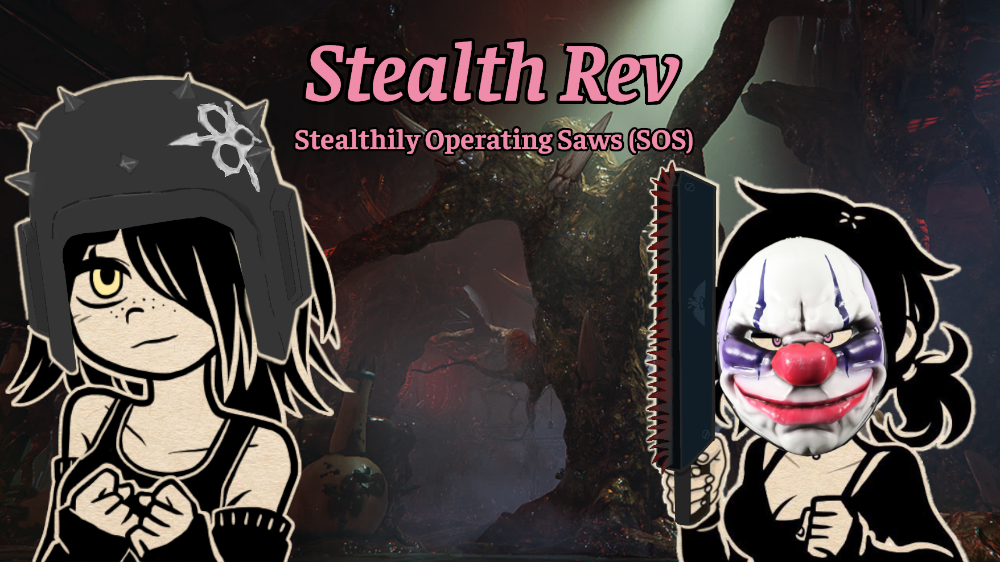

# Description
Reduces sound from activating the special action for chain weapons.

Revving up a chain weapon has two parts: the quick *VRR* on start, and the following *vrrRRRRR* that lingers for a bit. These both play at the same time, so think of it like the engine revving up and the actual chains spinning faster. These work off of separate systems, so they can be disabled separately.

**TL:DR**
- Quiet rev: Leave the initial startup on, disable the chain speedup
- Fully silent: Disable both sounds

Most of the sound is from the chain speedup, so just disabling the initial startup won't change much. By default, I have it set up for Quiet rev.

## Silencing the Initial Startup
This is part of the general player sound files. These can be silenced or reenabled per weapon.

Also, if you use [Silence Obnoxious Sounds](https://www.nexusmods.com/warhammer40kdarktide/mods/671), these do similar things. This mod affects each weapon individually, while that one targets the shared sounds. I recommend you only let one mod handle things at a time, or else Silence Obnoxious Sounds will overwrite the changes here.

## Silencing the Chain Speedup
This is done by editing how the game handles chain weapon events in general. This means it's all or nothing. 

On the technical side, this basically nukes `ChainWeaponEffects._update_intensity`, so there may be incompatibility issues with mods that try to edit the same thing. I don't know of any such mods, but it's a possibility that a mod that relies on that function will break when used with this mod.

